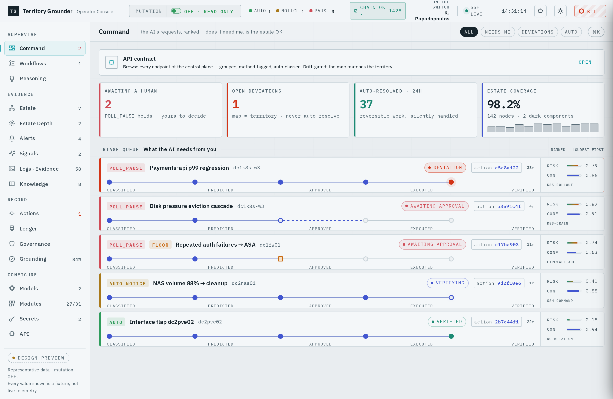
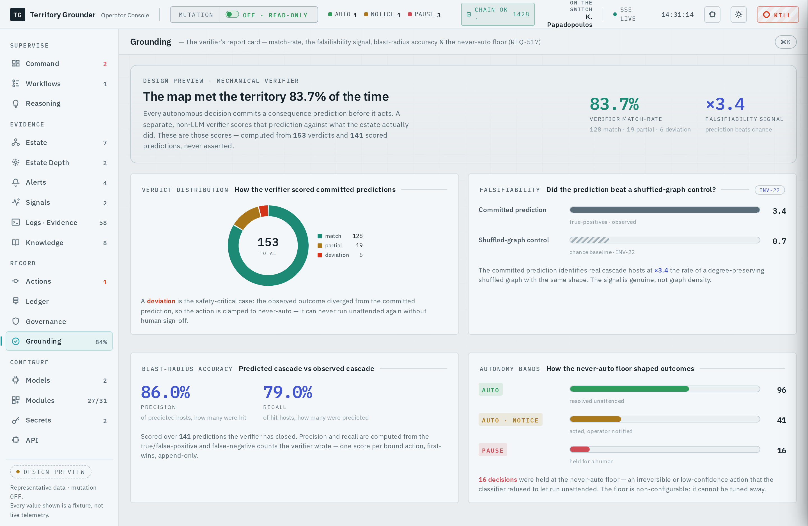
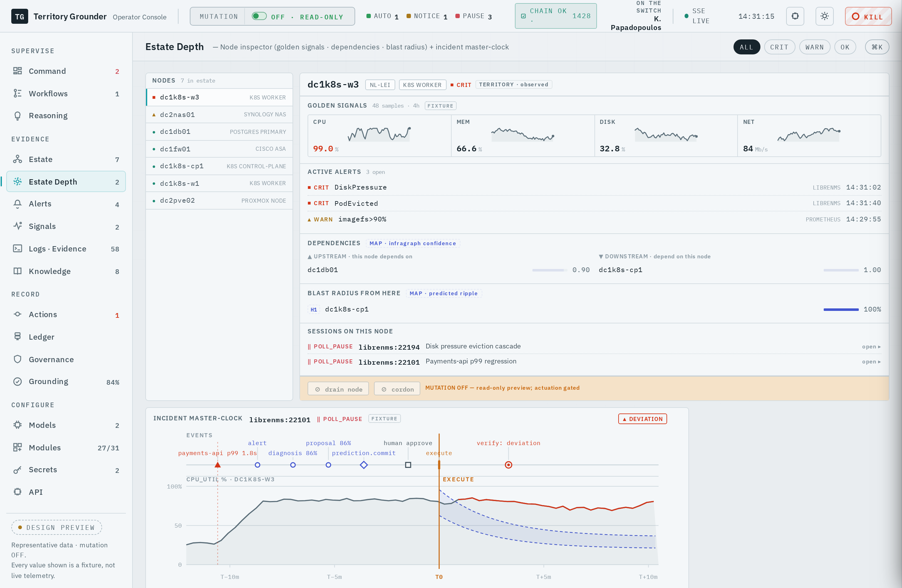
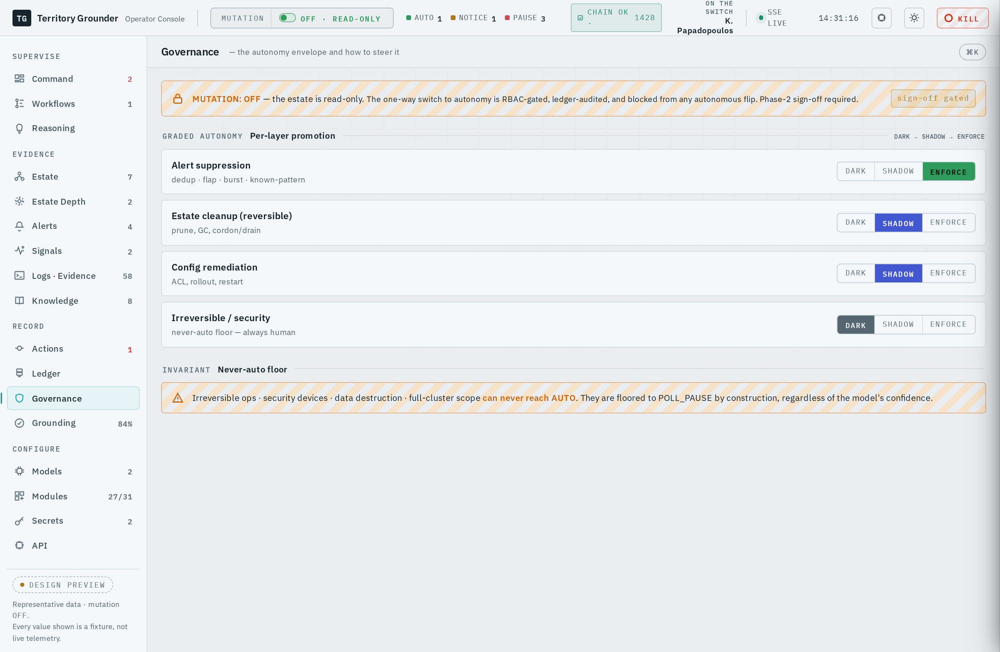

<div align="center">
  
</div>

<p align="center"><em>Autonomous remediation, grounded. It has a territory, a ledger, and a leash.</em></p>

<p align="center">
  <a href="LICENSE"></a>
  
  
  
  
</p>

**Territory Grounder** (`grounder`, alias `tg`) is an open-source, self-hosted governed-autonomy SRE
platform. It ingests alerts, chat, and tickets; lets a native LLM agent triage and, class by class as
evidence accrues, autonomously remediate infrastructure incidents; and wraps that agent in governance
strict enough to trust near production.

**Vision versus what is exercised (2026-11-07).** The paragraph above is the product's scope. What has
actually executed autonomously, on the reference deployment, is narrower: Proxmox guest start and systemd /
Docker unit and container start/restart, on injected faults against an expendable test pool at two sites
(graduation steps G1–G3, [`docs/CLAIMS-REGISTER.md`](docs/CLAIMS-REGISTER.md)). Every other lane named in
this file — Kubernetes, network devices, AWX-driven remediation, storage — exists as code and is either dark,
unwired or armed-but-never-exercised; the register says which. Investigation (triage, diagnosis, hold) runs
on every ingested alert; autonomous remediation has not run on an organic incident yet.

It is designed for sovereign and regulated estates: the control plane, state and ledger run inside the
adopter's own trust boundary with no SaaS dependency and no phone-home, and every decision is reconstructable
from the adopter's own database. The model calls are the exception and are stated plainly: the reference
deployment reasons through external providers (Azure OpenAI as the primary rail, an Anthropic lane as the
rescue rail and the judge — `deploy/litellm-config.yaml`). An air-gapped or local-model path exists only as
configuration (the Ollama module serves the embedding lane today); it has not been exercised for triage or
remediation, so it is a design goal here, not a demonstrated capability.

Its one principle, from which everything else follows:

> **The agent is not allowed to act on a belief it has not checked, and the check is not run by the model
> that made the claim.**

The prediction is committed in advance; a separate mechanism (code that reads logs, metrics, and state)
decides whether it came true. That independent error channel, the one thing allowed to tell the agent
"no", is the whole point. The reasoning is in the manifesto,
[**The Map Is Not the Territory**](https://kyriakos.papadopoulos.tech/posts/the-map-is-not-the-territory/)
by Kyriakos Papadopoulos (also in [`docs/`](docs/the-map-is-not-the-territory.md)).

## What makes it different

Territory Grounder is built for governed autonomous action, where the governance is mechanical rather than
asserted. The list below describes this system's own design; it is not a measured comparison with other
tools, and other products (OneUptime and Kubernaut among them) document overlapping verification and audit
features. No head-to-head against a third-party tool has been run — the only comparison on record is the
predecessor experiment in "Current state" below.

- **Fail-closed prediction gate.** A plan's blast radius is predicted and committed, keyed to an immutable
  content hash of the action, before any approval. An unpredicted mutating action is denied, not
  logged-and-allowed. The prediction is computed outside the LLM, so it is never the reasoner grading itself.
- **Mechanical verdicts.** After execution, deterministic code (never the model that acted) writes the only
  `match` / `partial` / `deviation` verdict. A deviation can never auto-resolve again.
- **A falsifiability control.** Every prediction is scored against a degree-preserving shuffled-graph
  control, so "the model was right" has to beat chance on a graph of the same shape, not merely look right.
- **Three-band autonomy.** `AUTO`, `AUTO_NOTICE`, `POLL_PAUSE`, with a non-configurable never-auto floor for
  anything irreversible or stateful, the human as a circuit-breaker rather than a per-action approver, and a
  one-file kill-switch. Who answers a `POLL_PAUSE` is a product role: the default resolver is `human` (a vote
  in the console); the owner's deployment runs `TG_APPROVAL_RESOLVER=autonomous`, where TG itself is the
  fallback approver and no human votes (spec/012 REQ-1127).
- **Tamper-resistant ledger.** Every decision is a SHA-256 hash-chained record, and the runtime database
  role is revoked `UPDATE`/`DELETE` on the append-only spine, so the accountability record cannot be
  rewritten even by the process that produced it.
- **Deterministic gate, no LLM in the safety path.** The admission and actuation gate consumes only typed,
  derived signals; model text is data, never control flow. There is no LLM to jailbreak into approving an
  action, and the gate never sees the agent's conversation.

## A look at it

The operator console is the human's window onto the governed loop. Representative data; every action is
gated by the mode chokepoint.

**Command.** The triage queue, ranked by what needs a human. Each incident carries its ActionManifest
timeline (classified, predicted, approved, executed, verified), risk, confidence, and band.

<p align="center"></p>

**Grounding.** The verifier's report card: match-rate, the falsifiability signal (real prediction versus a
shuffled-graph control), blast-radius precision and recall, and how the never-auto floor shaped outcomes.
The differentiator, published as evidence rather than asserted.

<p align="center"></p>

<table>
<tr>
<td width="50%"><b>Estate Depth</b>: the confidence-weighted causal graph the prediction gate reasons over, built from NetBox, Proxmox, and LibreNMS.<br><br></td>
<td width="50%"><b>Governance</b>: the live safety posture, mutation state, the autonomy-band distribution, and the hash-chained ledger head.<br><br></td>
</tr>
</table>

## Architecture

Territory Grounder is a single Go control-plane, [Temporal](https://temporal.io) for durable orchestration,
and PostgreSQL with `pgvector` for state, memory, and ledger. It is model-agnostic: any LLM reachable by
API, through a bundled LiteLLM gateway that presents one OpenAI-compatible endpoint with per-org budgets
and an optional multi-provider fallback ladder. The reference deployment (`deploy/litellm-config.yaml`,
2026-08-22 and 2026-08-31 rulings) runs triage on Azure OpenAI (`gpt-4.1` primary, `gpt-5.4-mini` fast) with
a Claude rescue lane (Sonnet, then Fable) that catches content-filter refusals and provider errors; the judge
is Claude Opus on a separate alias with no fallback, so a judge outage is loud. The referee therefore shares
a model family with the rescue lane and with the predecessor it was compared against — a disclosed confound,
not an isolation guarantee (`tools/shadowbench/PRE-REGISTRATION.md` § 6, 2026-08-25). The container images
are distroless and static, with no shell and no interpreter in the runtime.

The system is organized as concentric layers, from the durable spine out to the estate.

### The durable spine

- **Runner workflow** (`temporal/runner/`). One Temporal workflow per incident: acquire a per-target lock,
  honor a cooldown, retrieve precedent, classify risk, commit a prediction, build the agent seed, run the
  agent loop, parse the proposal, screen it, and pass it through the prediction gate. In Phase 0/1 it stops
  at propose. The workflow is deterministic and restart-safe (Temporal replay), so a control-plane restart
  never loses or double-runs an incident.
- **Risk classifier** (`core/risk/`). A deterministic three-band admission gate: most-restrictive wins, it
  fails closed to `POLL_PAUSE`, and it clamps anything the immutable never-auto floor names down to a human
  poll. Every classification writes an audit record.
- **Prediction gate** (`core/predict/`). The sole constructor of a gated proposal. A proposal without a
  committed, content-hashed prediction is default-denied. The prediction records the estate blast radius the
  action is expected to cause, so the verifier has something falsifiable to check.
- **Mechanical verdict** (`core/verify/`). Deterministic code diffs what actually happened against what was
  predicted and writes the sole `match`/`partial`/`deviation` verdict. A deviation forces the op onto the
  never-auto floor.
- **Governance ledger** (`core/audit/`). An append-only, SHA-256 prev-row hash-chained decision log, with a
  `LedgerVerifier` that re-walks the chain. The runtime role holds `INSERT` and `SELECT` only on the spine
  tables (`UPDATE`/`DELETE` revoked at the database), so the record is tamper-resistant, not merely
  tamper-evident.
- **Mutation gate + breaker** (`core/safety/`). The `MutationGate` defaults false and can only be enabled
  through one proof-obligated path that fails closed. The mutation breaker, once armed, refuses further
  mutating actions and can be tripped by a deviation, a policy hit, or the one-file kill-switch.

### The agent

- **Native Go agent loop** (`agent/`). A ReAct-style tool-calling loop over the LiteLLM gateway, calling
  read-only investigation tools directly. No Claude Code subprocess, no shell. It emits a typed proposal
  through a single proposal grammar; no model token becomes control flow (a hard invariant). Handoff and
  cycle limits force a decision at the poll boundary rather than looping.
- **Execution classes and skills** (`core/execclass/`, `agent/skills/`). Each incident is classified into a
  `FastAgent`, `StandardAgent`, or `DeepInvestigation` class, which deterministically composes the behavioral
  skills loaded into the seed. Skills are a typed, versioned registry (proving-your-work, the investigation
  protocol, the conservative-remediation catalog, per-alert-class playbooks), selected by a pure function of
  typed signals.
- **Knowledge plane** (`core/knowledge/`). Dual-channel retrieval: a lexical index and a `pgvector` semantic
  channel (768-dimension HNSW cosine top-K), fused with reciprocal-rank fusion and a minimum-similarity
  floor. It degrades honestly to the lexical result on any embedding failure. A derived wiki surfaces what
  the system knows.
- **Prompt-injection screen** (`core/screen/`). A deterministic screen at both untrusted-input boundaries
  (the ingest seed and tool results at loop re-entry). A jailbreak attempt forces `POLL_PAUSE`.

### The world model

- **Estate causal graph** (`core/estate/`). A declared, confidence-weighted dependency graph built from the
  estate's own source of truth (NetBox, Proxmox, LibreNMS), refreshed on a schedule. It carries `runs_on`
  and `depends_on` edges and a `Siblings` relation that catches co-failure where a shared parent never
  alerts (for example several guests flapping on one hypervisor).
- **Falsifiability writeback** (`core/falsify/`). The prediction gate reasons over this graph outside the
  LLM to predict a blast radius. After the window, the scorer compares the predicted set against what
  actually alerted and against a degree-preserving shuffled-graph control, so the signal has to beat a graph
  of the same shape, not just look plausible.

### The effect channel

- **Argv-only actuator** (`adapters/actuation/`, `modules/actuation/ssh/`). A native Go `crypto/ssh` runner
  that executes actions as argument vectors, never a shell string, so OS-command injection is
  unrepresentable. It is registry-gated to a reversible-op allowlist and can only actuate behind the mode
  chokepoint — an absent/zero/corrupt mode is Shadow (read-only, no actuate). The mutating path is
  security-reviewed and lab-validated against a real sshd.
- **Interceptor chain** (`core/actuate/`). A single pre-execution chokepoint that every command traverses:
  admission, territory and egress checks, policy, execute, audit. An unwired interceptor fails boot, so a
  dark control cannot ship.

### Adapters, modules, and the console

- **Adapters and modules** (`adapters/`, `modules/`). The `adapters/` layer defines the module interfaces
  (alert-source, chat and human-in-the-loop, ticketing, CMDB, actuation, model-provider, observability). The
  `modules/` layer implements them: a reference fleet of roughly thirty connectors, including LibreNMS
  ingest (push front door plus an opt-in pull fallback), NetBox, Proxmox, CrowdSec, syslog-ng,
  Alertmanager, and chat bridges, across two sites. A connector in `modules/` is a compiled capability, not a
  deployed one: the Kubernetes kubectl/helm actuation module is wired into no worker, the Cisco read and
  write lanes are dark on the reference deployment (no devices declared), and the AWX job lane is unarmed;
  the cluster alerts TG sees from Kubernetes arrive through Alertmanager ingest (see the register).
- **Operator console** (`deploy/console/v2/` — a framework-free, self-contained HTML artifact
  assembled by `assemble.py`, byte-verified in CI, guarded by Playwright oracles). Twenty-two
  surfaces over authenticated HTTPS: the triage queue, approve and deny on POLL_PAUSE rows, the
  mutation-breaker admin control, the ActionManifest timeline, the ledger, the estate graph, the
  Grounding scorecard, the knowledge wiki, and the skill store. A handful of views still render
  explicitly-labelled fixture data while their live wiring lands.
- **Configuration and secrets** (`core/config/`). Console-native, law-clamped configuration resolution and a
  sealed secret store. Secrets are references (`file:` or the sealed store), never literals in code or the
  process environment.

## The governed loop

```
alert / chat / ticket  ->  adapter  ->  Temporal workflow
                                            |
                            predict  ->  commit prediction   (the gate)
                                            |
                                        act   (bounded to its territory)
                                            |
                      independent verify  ->  verdict  ->  hash-chained ledger
                                            |
                            band:  AUTO . AUTO_NOTICE . POLL_PAUSE
```

Predict, act, be surprised, update. Keep the one channel that is allowed to say no. It turns out to be most
of the job. The same epistemology sits behind the estate world model: the system predicts consequences
before acting and measures surprise when reality diverges, then routes surprise into a never-auto disposition
instead of a silent retry.

## Grounding as evidence

The platform does not ask to be trusted; it publishes the evidence.

- **Grounding scorecard.** A live report of match-rate, the falsifiability signal against the shuffled-graph
  control, blast-radius precision and recall, and the never-auto floor's effect, served at `/v1/grounding`
  and on the console.
- **Binding eval gate.** A change that touches triage behavior is gated by an on-box A/B evaluation: the
  candidate versus a fresh baseline arm over the same corpus in the same window, drift-cancelled, with a
  hard mechanical bar. Quality changes ship only on a passing scorecard.
- **Skill-store flywheel.** The system scores its own sessions, generates candidate skill and prompt
  variants, runs them as controlled trials, and graduates a winner only when it beats a control. Prompt-level
  policy iteration, with no model weights ever fine-tuned.
- **A predecessor experiment, not a third-party benchmark.** `tools/shadowbench/` compares Territory Grounder
  with the system it replaced, on the same injected faults, under a pre-registered analysis. It is an internal
  comparison against one incumbent built by the same author; no neutral or third-party suite has been run.

## Current state (by outcome, 2026-11-07)

Status is reported as executions, refusals and verdicts, never as configuration. Sources: `docs/BOARD.md`
(2026-11-07), `docs/history/BOARD-JOURNAL-2026-11.md`, the worker boot logs of 2026-11-07, and the G4A
review evidence pack; the per-claim basis is in [`docs/CLAIMS-REGISTER.md`](docs/CLAIMS-REGISTER.md).

- **Investigation** runs on every ingested alert at both sites: detect, classify, diagnose, propose or hold.
  Mode is Semi-auto with the autonomous fallback approver; the mutation breaker, the never-auto floor, the
  `/halt` kill-switch and the mode chokepoint are live.
- **Autonomous remediation has executed only on synthetic faults.** The graduation soak (G1 on 11-05, G2 on
  11-06, G3 on 11-07) injected device-down, service-down, container-down and hang faults on an expendable pool
  and counted `verified_clean` credits per op-class: start-guest 16, start-service, start-container,
  restart-container and restart-service 15 each, at both sites, including QEMU guests. In the review cohort of
  159 sessions, 42 were organic incidents and **none of them produced an execution**.
- **Credits are not yet verified causal recoveries.** The review of 2026-11-07 found the credit predicate
  trusted a commit-confirm `match` alone and found fail-open readers behind it; the corrected predicate
  (TG-662 and companions) is in flight and the G3 credits are being recomputed under it, not trusted as-is.
  Three corrections to the earlier episode join stand: one fault (1670) was not healed by TG; the credited
  cohort is 69 faults (GR 44 / NL 25); two executions fall outside any fault's ownership interval, and the
  site on an execution is stamped by the session, not by the target.
- **Lanes.** Exercised: Proxmox guest start (LXC and QEMU) and SSH-driven systemd/Docker start and restart
  on allowlisted non-stateful units and containers. Armed but never executed: the GitOps merge-request lane
  (Argo CD convergence reader armed). Dark on the reference deployment: Cisco read and write (no devices
  declared), AWX job launch (unconfigured). Unwired: the kubectl/helm actuation module. A dark or armed lane
  is not a supported one.
- **The predecessor experiment (campaign #3, 2026-08-26).** 32 paired faults submitted, 30 analysed across 13
  hosts (at most 3 per host). On the judge-free primary endpoint — did the system propose the op-class that
  addresses the injected fault — TG alone was correct on 7 pairs and the predecessor alone on 0 (McNemar
  exact p = 0.016); the frozen rule returns **TG MATCHES (non-inferior)**. Read the rest before the headline:
  of the 23 concordant pairs at most 4 were both-correct and at least 19 were both-wrong (every service-down
  and container-down fault defeated both systems), so concordance is not correctness; the judged secondary
  dimensions **favoured the predecessor significantly** on correct_diagnosis and evidence_grounded (Holm
  p ≤ 0.0006); the judge shares a model family with the predecessor; the McNemar p-value treats seven
  discordant pairs as independent although ten of thirteen hosts contributed two to four pairs (the
  confidence intervals are host-clustered, the p-value is not); and the primary endpoint's documentation
  differs between the pre-registration and the frozen record (details in the register). The earlier campaign
  (#1, 2026-07-31) was under-powered and read PREDECESSOR HOLDS.

## Roadmap

Five phases. Actuation is gated by the mode chokepoint: the platform first ran the entire loop read-only —
proving it could act without acting — and Phase 2's gate now governs a live, owner-set mode (default/absent/
corrupt ⇒ Shadow, no actuate).

| Phase | What | Status |
|-------|------|--------|
| **0. Secure foundation** | Mandatory-auth router (no unauthenticated route), argv-only actuation (no shell), one-DSN database with a DML-only runtime role, secrets-as-references, the fail-closed `MutationGate` plus boot preflight | Done |
| **1. Typed spine (read-only)** | Ingest to typed envelope to risk classifier to native agent loop to prediction gate to mechanical verdict to hash-chained ledger; the Runner workflow that stops at propose; the connector fleet; the operator console; the live estate graph; the Grounding scorecard | Live (deployed, read-only) |
| **2. Governed autonomy** | The wired-by-construction actuation interceptor chain, the human vote-consuming approval loop, and turning the mutation key behind the proven gate, a green preflight, and a readiness review | Built; actuation enabled (mode-gated, owner-set Semi-auto) |
| **3. Anti-drift and lifecycle** | Single-source-of-truth reconciliation, drift correction, regime-aware actuation (direct on runtime, merge-request on GitOps-managed targets), safe decommission | Planned; the regime engine and the GitOps merge-request actuator are built and armed, 0 executions; G5 preconditions in `docs/K8S-MANAGEMENT-REGIME-DESIGN.md` § 7 |
| **4. Adversarial assurance** | The assurance gate: adversarial boundary-coverage, sealed-holdout evaluations, published third-party benchmarks | Planned |

### Coming soon — the earned op-class ladder (in flight)

The largest architectural direction is being built now, and the reason is worth stating plainly: a governed
system that only ever acts through a hand-authored catalog makes every new deployment a configuration
project. The predecessor this platform was ported from *earned* its autonomy under supervision; the port
brought across the safety and left the earning behind. This closes that gap.

Already merged and live:

- **Open proposal plane** — with an EMPTY catalog, triage still runs to completion and emits free-form
  remediation proposals: ledgered, rendered, and structurally unexecutable. Day-zero Territory Grounder is a
  full shadow adviser with zero configuration.
- **Observation arm** — recurring proposals accrete into op-class *candidates* with evidence dossiers.
  Occurrence credit is exactly-once by database key, the journal is append-only by privilege, and a dead-man
  refuses the pass loudly if the evidence stream goes stale.
- **World model** — discovery over the estate's own sources of truth (NetBox, Proxmox, systemd, docker)
  drafts a manifest the operator *reviews* rather than authors; adopted entries materialise the allowlists,
  drift returns as one-click adoptions, and vanished entries go stale but are never auto-retired.

Merged ([MR !794](https://github.com/territory-grounder/grounder/-/merge_requests/794)):

- **The ratify lane and the earned overlay** — an operator turns a dossier into a real op-class through a
  structurally empty form (model text renders only as quoted, untrusted exhibits; a template that
  byte-matches the model's own words is refused outright). Grants are append-only rows bound to the hash
  chain, and the class then climbs a per-class ladder on verified evidence.
- **The AUTO ceiling** — a runtime-granted class can climb to AUTO_NOTICE and no further. The silent rung,
  where no human watches, requires the class to be promoted into the compiled, lockstep-hashed registry via a
  generated merge request. The difference is not how well a class performed; it is which tamper domain grants
  it.

Beyond that, several product directions are designed and tracked: platform packs that ship
portable, doc-grounded competence for common platforms (Cisco IOS and ASA, Kubernetes, Linux) so a fresh
install is capable before it has seen the estate — the `cisco` and `kubernetes` knowledge packs load on the
reference deployment, while the Cisco read/write lanes and the kubectl module they would drive are dark or
unwired there; an autonomy-onboarding flow that graduates mutation
per-scope as evidence accrues on the customer's own estate; commit-confirmed auto-reverting mutations (apply,
arm a rollback timer, confirm only on a verified prediction, otherwise self-revert); and a learned-parameter
calibration of the estate world model, evaluated against the same falsifiability control. See
[`docs/ROADMAP.md`](docs/ROADMAP.md) and [`docs/IMPROVEMENT-TARGETS.md`](docs/IMPROVEMENT-TARGETS.md).

## Repository layout

| Path | Role |
|------|------|
| [`core/`](core/) | prediction gate, verdict engine, tamper-resistant ledger, risk classifier, safety gate and breaker, reconcile loop, the actuation interceptor, the estate graph, the knowledge plane |
| [`agent/`](agent/) | native Go agent loop (calls LLM APIs directly) and the skills registry |
| [`adapters/`](adapters/) | the module interfaces: alert-source, chat, ticketing, CMDB, actuation, model-provider, observability |
| [`modules/`](modules/) | loadable integration modules implementing the `adapters/` interfaces, plus the reference fleet |
| [`temporal/`](temporal/) | Temporal workflow and activity definitions (the Runner, the flywheel, the judge crons) |
| [`eval/`](eval/) | the binding change-gate evaluation harness and corpus |
| [`deploy/`](deploy/) | the `docker-compose` stack, the operator console, and the bundled LiteLLM gateway |
| [`spec/`](spec/) | the executable spec lattice: EARS requirements, runnable acceptance oracles, spec-to-code lockstep |
| [`docs/`](docs/) | the manifesto and the full documentation set (start at [`docs/00-README.md`](docs/00-README.md)) |

This is a monorepo: one Go module, one version, many images (each service subdirectory builds its own
container). The full local gate is `make all` (vet, lint, spec, test, build). Continuous integration runs the
same gate with no Postgres or Temporal service, so every acceptance oracle is pure Go: persistence sits
behind repository interfaces with in-memory fakes, and the `pgx` implementations are integration-tested under
compose.

## Running it

The platform deploys as a Docker Compose stack (control-plane, worker, Temporal, PostgreSQL with `pgvector`,
the console, the LiteLLM gateway, and the observability services). Bring your own model API keys; nothing
leaves your network except the model calls you configure. Pointing those at a local model is a configuration
option that has not been exercised for triage on any deployment we can cite (only the embedding lane runs
locally); treat it as untested. See
[`docs/00-README.md`](docs/00-README.md) for the deployment guide, and `grounder --check` for the boot
preflight that proves the safety base without enabling mutation.

## Mission and use policy

Territory Grounder does not work with any organisation that develops, produces, integrates or operates weapon systems, and provides nothing for use in one, or in the infrastructure that runs one. The Apache-2.0 licence below is unchanged: the policy covers whom I work with, not what you may do with the code. Read the [Territory Grounder Mission and Use Policy](https://territorygrounder.com/policy/).

## License

[Apache-2.0](LICENSE). Copyright 2026 Kyriakos Papadopoulos.
